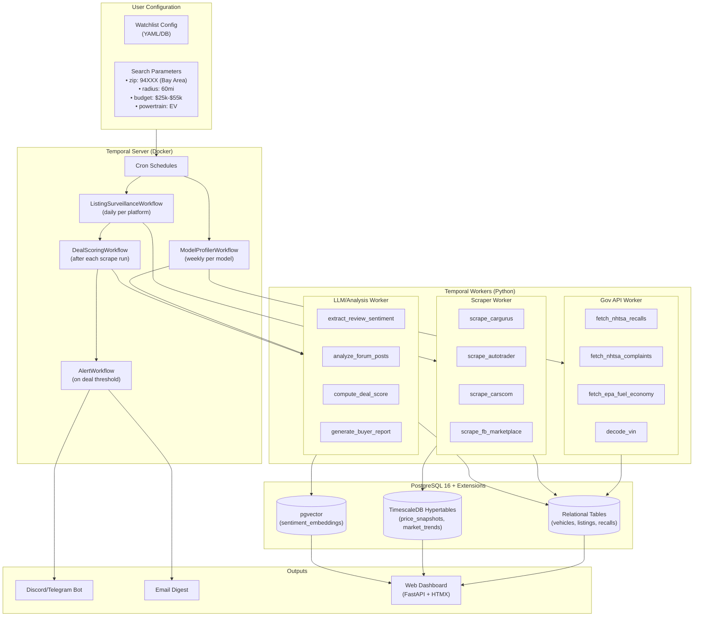

# System Architecture: Car Research Agent Pipeline

## 1. Technology Decisions & Rationale

### 1.1 Orchestration: Temporal (over Dagster)

Given that you've used Dagster before, here's why **Temporal** is the stronger choice for this specific project:

| Dimension | Dagster (what you know) | Temporal (recommended) |
|:---|:---|:---|
| **Core paradigm** | Asset-centric data orchestration — "what state is this data in?" | Durable execution engine — "this code runs to completion, no matter what" |
| **Agent workflows** | Awkward fit — agents aren't pure DAGs. Branching, retries, and human-in-the-loop require workarounds | Native fit — workflows can pause indefinitely (Signals/Queries), branch dynamically, and span days |
| **Failure handling** | Task retries within a run | Event-sourced replay — if a worker crashes mid-scrape, it resumes from the exact line of code |
| **Scheduling** | Built-in schedules and sensors | Cron workflows — identical capability, plus ad-hoc triggers via Signals |
| **Extensibility** | Python-only | First-class Python, Go, TypeScript, Java SDKs — you can mix languages per worker |
| **Scraping fit** | Designed for batch ETL; less natural for "scrape → decide → scrape more → score → alert" | Perfect for multi-step, decision-heavy workflows with retries and timeouts per step |

> [!IMPORTANT]
> **Key Temporal constraint**: Workflow code must be **deterministic** (no random values, no direct API calls). All I/O and non-deterministic logic lives in **Activities**. This actually enforces a clean separation of orchestration from execution — ideal for a modular system.

### 1.2 Language: Python (primary) with Go option for future scaling

| Consideration | Python | Go |
|:---|:---|:---|
| **LLM/AI tooling** | Dominant ecosystem (OpenAI SDK, LangChain, sentence-transformers) | Limited; would need to call Python services |
| **Web scraping** | Playwright (async), BeautifulSoup, httpx — mature and battle-tested | Colly, Rod — capable but smaller ecosystem |
| **Temporal SDK** | Excellent, native asyncio | Excellent, arguably the best SDK |
| **Data processing** | pandas, polars, scikit-learn for deal scoring | Would need to reimplement or call Python |
| **Verdict** | ✅ **Start here** — covers 100% of needs at our scale | 🔄 Introduce later only if scraping throughput demands it |

**At our scale** (Bay Area, 60mi radius, EVs, hundreds to low-thousands of listings across platforms), Python with async Playwright is more than sufficient. Go workers can be added later for high-throughput scraping without changing the architecture — Temporal supports mixed-language workers on the same task queue.

### 1.3 Database: Single PostgreSQL with Extensions

Rather than operating three separate databases, we consolidate into **one PostgreSQL instance** with two extensions:

```
┌─────────────────────────────────────────────────────────────┐
│                  PostgreSQL 16+ (Single Instance)           │
│                                                             │
│  ┌─────────────────────┐       ┌─────────────────────────┐  │
│  │    TimescaleDB       │       │       pgvector          │  │
│  │  (Time-Series Data)  │       │  (Vector Embeddings)    │  │
│  │                      │       │                         │  │
│  │  • Price snapshots   │       │  • Forum post embeds    │  │
│  │  • DOM tracking      │       │  • Review sentiment     │  │
│  │  • Inventory velocity│       │  • Listing description  │  │
│  │  • Market trends     │       │    similarity search    │  │
│  └──────────────────────┘       └─────────────────────────┘  │
│                                                             │
│  Standard relational tables:                                │
│  • vehicles, trims, specs, recalls, complaints              │
│  • listings, price_history, deal_scores                     │
│  • watchlist, search_configs, alerts                        │
│                                                             │
└─────────────────────────────────────────────────────────────┘
```

**Why single-instance Postgres over polyglot persistence:**

- **Operational simplicity**: One backup strategy, one connection pool, one migration system
- **Transactional integrity**: Foreign keys between time-series price data and relational listing records — no cross-database consistency headaches
- **Hybrid queries**: Filter by time range (TimescaleDB chunk pruning) *then* vector similarity search in one SQL query — impossible with separate databases without an application-layer join
- **Scaling runway**: A properly tuned single Postgres instance on NVMe SSD handles millions of rows. If we ever outgrow it, pgvectorscale (disk-based ANN) or Citus (distributed PG) extend without a rewrite

### 1.4 Web Scraping: Playwright (Async Python) + API Interception

For listing platforms (CarGurus, Autotrader, Cars.com, Facebook Marketplace):

- **Playwright with stealth patches** (`playwright-stealth`) to bypass anti-bot (Cloudflare, DataDome)
- **API interception over DOM scraping**: Intercept internal XHR/JSON endpoints (`page.on("response", ...)`) — 10x faster and immune to UI layout changes
- **Residential proxy rotation** for production stability (datacenter IPs get blocked instantly)
- **Semaphore-controlled concurrency** (3–5 concurrent contexts) with randomized human-like delays

For government APIs (NHTSA, EPA): simple `httpx` async HTTP calls — no browser needed.

---

## 2. System Architecture



---

## 3. Temporal Workflow Design

### 3.1 Workflow Hierarchy

```
┌─ ScheduledDailyPipeline (Cron: "0 6 * * *")
│
├─── ModelProfilerWorkflow (Child, per model in watchlist)
│    ├── Activity: fetch_nhtsa_recalls(make, model, year)
│    ├── Activity: fetch_nhtsa_complaints(make, model, year)
│    ├── Activity: fetch_epa_data(make, model, year)
│    ├── Activity: scrape_iihs_ratings(make, model, year)
│    ├── Activity: search_class_actions(make, model, year)
│    ├── Activity: mine_reddit_sentiment(make, model, subreddits)
│    ├── Activity: extract_youtube_reviews(make, model)
│    └── Activity: upsert_model_profile(profile_data)
│
├─── ListingSurveillanceWorkflow (Child, per platform)
│    ├── Activity: scrape_platform(platform, search_params)
│    ├── Activity: deduplicate_listings(raw_listings)
│    ├── Activity: decode_vins(vin_list)
│    ├── Activity: upsert_listings(listings)
│    └── Activity: snapshot_prices(listings)  → TimescaleDB
│
└─── DealScoringWorkflow (Child, after all surveillance completes)
     ├── Activity: compute_market_statistics(model, year)
     ├── Activity: score_all_active_listings(model_stats)
     ├── Activity: detect_price_drops(since_last_run)
     ├── Activity: rank_deals(scored_listings)
     └── Condition: if top_deal.score > threshold
         └── AlertWorkflow
             ├── Activity: format_alert(deal)
             └── Activity: send_notification(channel, message)
```

### 3.2 Key Design Patterns

| Pattern | How We Use It |
|:---|:---|
| **Child Workflows** | One per model, one per platform — independent retry/failure isolation |
| **Activity Retry Policies** | Scraper activities: 3 attempts, exponential backoff. Gov APIs: 5 attempts (they're flaky). LLM: 2 attempts |
| **Heartbeating** | Playwright scraper activities heartbeat every 10s so Temporal knows they're alive during slow page loads |
| **ContinueAsNew** | Long-running surveillance workflows reset their history periodically to prevent event log bloat |
| **Signals** | External trigger: "add this VIN to watchlist" sends a Signal to the running pipeline, immediately triggering a targeted scrape |
| **Queries** | Dashboard queries the running workflow for real-time status: "how many listings scraped so far today?" |

---

## 4. Data Model (PostgreSQL Schema Overview)

### 4.1 Core Relational Tables

```sql
-- Extension setup
CREATE EXTENSION IF NOT EXISTS timescaledb;
CREATE EXTENSION IF NOT EXISTS vector;
CREATE EXTENSION IF NOT EXISTS pg_trgm;  -- fuzzy text search

-- ============================================
-- CONFIGURATION
-- ============================================
CREATE TABLE search_configs (
    id              UUID PRIMARY KEY DEFAULT gen_random_uuid(),
    name            TEXT NOT NULL,              -- "Bay Area EV Search"
    zip_code        TEXT NOT NULL DEFAULT '94103',
    radius_miles    INT NOT NULL DEFAULT 60,
    min_price       INT,
    max_price       INT,
    min_year        INT,
    max_year        INT,
    powertrain      TEXT[],                     -- {'BEV', 'PHEV'}
    makes_models    JSONB,                      -- [{"make":"Tesla","model":"Model Y"}, ...]
    is_active       BOOLEAN DEFAULT true,
    created_at      TIMESTAMPTZ DEFAULT NOW(),
    updated_at      TIMESTAMPTZ DEFAULT NOW()
);

-- ============================================
-- VEHICLE KNOWLEDGE BASE (Model-Level)
-- ============================================
CREATE TABLE vehicle_models (
    id              UUID PRIMARY KEY DEFAULT gen_random_uuid(),
    make            TEXT NOT NULL,
    model           TEXT NOT NULL,
    year            INT NOT NULL,
    generation_code TEXT,                        -- e.g., "Highland", "G20"
    trim            TEXT,
    powertrain_type TEXT,                        -- 'BEV', 'PHEV', 'HEV', 'ICE'
    base_msrp       INT,
    specs           JSONB,                       -- battery_kwh, range_mi, charging_kw, etc.
    UNIQUE (make, model, year, trim)
);

CREATE TABLE recalls (
    id              UUID PRIMARY KEY DEFAULT gen_random_uuid(),
    vehicle_model_id UUID REFERENCES vehicle_models(id),
    nhtsa_campaign  TEXT UNIQUE,
    component       TEXT,
    summary         TEXT,
    consequence     TEXT,
    remedy          TEXT,
    report_date     DATE,
    is_open         BOOLEAN DEFAULT true
);

CREATE TABLE complaints (
    id              UUID PRIMARY KEY DEFAULT gen_random_uuid(),
    vehicle_model_id UUID REFERENCES vehicle_models(id),
    nhtsa_id        TEXT UNIQUE,
    component       TEXT,
    description     TEXT,
    crash           BOOLEAN,
    fire            BOOLEAN,
    date_filed      DATE
);

CREATE TABLE model_profiles (
    id              UUID PRIMARY KEY DEFAULT gen_random_uuid(),
    vehicle_model_id UUID REFERENCES vehicle_models(id) UNIQUE,
    iihs_overall    TEXT,                        -- 'TOP_SAFETY_PICK_PLUS', etc.
    nhtsa_stars     FLOAT,
    reliability_score FLOAT,                    -- composite from CR, RepairPal
    avg_annual_repair_cost INT,
    known_issues    JSONB,                       -- [{issue, severity, fix_cost}]
    class_actions   JSONB,                       -- [{case_name, status, details}]
    carb_compliant  BOOLEAN,
    subscription_fees JSONB,                    -- [{feature, annual_cost}]
    profiled_at     TIMESTAMPTZ DEFAULT NOW()
);

-- ============================================
-- LISTINGS (Listing-Level)
-- ============================================
CREATE TABLE listings (
    id              UUID PRIMARY KEY DEFAULT gen_random_uuid(),
    vin             TEXT,
    vehicle_model_id UUID REFERENCES vehicle_models(id),
    platform        TEXT NOT NULL,               -- 'cargurus', 'autotrader', etc.
    platform_id     TEXT,                        -- platform-specific listing ID
    url             TEXT,
    title           TEXT,
    price           INT,
    mileage         INT,
    exterior_color  TEXT,
    interior_color  TEXT,
    trim_detail     TEXT,
    seller_type     TEXT,                        -- 'dealer', 'private', 'carvana'
    seller_name     TEXT,
    seller_rating   FLOAT,
    location_city   TEXT,
    location_state  TEXT,
    distance_miles  FLOAT,
    title_status    TEXT DEFAULT 'clean',        -- 'clean', 'salvage', 'rebuilt', 'lemon'
    accident_count  INT DEFAULT 0,
    owner_count     INT,
    photos          TEXT[],
    raw_data        JSONB,                       -- full scraped payload
    first_seen      TIMESTAMPTZ DEFAULT NOW(),
    last_seen       TIMESTAMPTZ DEFAULT NOW(),
    is_active       BOOLEAN DEFAULT true,
    UNIQUE (platform, platform_id)
);

CREATE INDEX idx_listings_active ON listings (is_active, platform)
    WHERE is_active = true;
CREATE INDEX idx_listings_vin ON listings (vin) WHERE vin IS NOT NULL;
CREATE INDEX idx_listings_price ON listings (price);

-- ============================================
-- DEAL SCORING
-- ============================================
CREATE TABLE deal_scores (
    id              UUID PRIMARY KEY DEFAULT gen_random_uuid(),
    listing_id      UUID REFERENCES listings(id),
    market_value    INT,                        -- algorithmic fair market value
    price_delta     INT,                        -- listed_price - market_value (negative = deal)
    deal_score      FLOAT,                      -- composite 0-100
    score_breakdown JSONB,                      -- {price: 85, history: 70, condition: 90, ...}
    scored_at       TIMESTAMPTZ DEFAULT NOW()
);

-- ============================================
-- SENTIMENT & EMBEDDINGS (pgvector)
-- ============================================
CREATE TABLE review_embeddings (
    id              UUID PRIMARY KEY DEFAULT gen_random_uuid(),
    vehicle_model_id UUID REFERENCES vehicle_models(id),
    source          TEXT,                        -- 'reddit', 'youtube', 'forum'
    source_url      TEXT,
    content_summary TEXT,
    sentiment_score FLOAT,                      -- -1.0 to 1.0
    topics          TEXT[],                      -- ['battery_degradation', 'charging', 'range']
    embedding       VECTOR(384),                -- sentence-transformer embedding
    created_at      TIMESTAMPTZ DEFAULT NOW()
);

CREATE INDEX idx_review_embedding_hnsw
    ON review_embeddings
    USING hnsw (embedding vector_cosine_ops)
    WITH (m = 16, ef_construction = 64);
```

### 4.2 Time-Series Tables (TimescaleDB Hypertables)

```sql
-- Price snapshots — one row per listing per day
CREATE TABLE price_snapshots (
    time            TIMESTAMPTZ NOT NULL,
    listing_id      UUID NOT NULL,              -- FK managed at app level for hypertable compat
    price           INT NOT NULL,
    days_on_market  INT,
    price_change    INT DEFAULT 0               -- delta from previous snapshot
);

SELECT create_hypertable('price_snapshots', 'time');
CREATE INDEX idx_price_snap_listing ON price_snapshots (listing_id, time DESC);

-- Compress chunks older than 30 days
ALTER TABLE price_snapshots SET (
    timescaledb.compress,
    timescaledb.compress_segmentby = 'listing_id'
);
SELECT add_compression_policy('price_snapshots', INTERVAL '30 days');

-- Market-level aggregates — one row per model per day
CREATE TABLE market_snapshots (
    time            TIMESTAMPTZ NOT NULL,
    make            TEXT NOT NULL,
    model           TEXT NOT NULL,
    year            INT NOT NULL,
    region          TEXT NOT NULL,               -- 'bay_area_60mi'
    active_listings INT,
    median_price    INT,
    avg_price       INT,
    p10_price       INT,                        -- 10th percentile
    p90_price       INT,                        -- 90th percentile
    avg_mileage     INT,
    avg_dom         FLOAT,                      -- average days on market
    new_listings    INT,                        -- appeared since yesterday
    removed_listings INT                        -- disappeared since yesterday
);

SELECT create_hypertable('market_snapshots', 'time');
```

---

## 5. Project Structure

```
researcher/
├── docs/
│   ├── car-research-agent-data-taxonomy.md
│   └── architecture.md                         ← this file
├── src/
│   ├── config/
│   │   ├── __init__.py
│   │   └── settings.py                         # Pydantic Settings (env vars, defaults)
│   ├── models/
│   │   ├── __init__.py
│   │   └── domain.py                           # Dataclasses for Temporal payloads
│   ├── db/
│   │   ├── __init__.py
│   │   ├── engine.py                           # SQLAlchemy async engine + session
│   │   ├── models.py                           # SQLAlchemy ORM models
│   │   └── migrations/                         # Alembic migrations
│   ├── workflows/
│   │   ├── __init__.py
│   │   ├── daily_pipeline.py                   # ScheduledDailyPipeline workflow
│   │   ├── model_profiler.py                   # ModelProfilerWorkflow
│   │   ├── listing_surveillance.py             # ListingSurveillanceWorkflow
│   │   ├── deal_scoring.py                     # DealScoringWorkflow
│   │   └── alerting.py                         # AlertWorkflow
│   ├── activities/
│   │   ├── __init__.py
│   │   ├── gov_apis.py                         # NHTSA, EPA fetch activities
│   │   ├── scrapers/
│   │   │   ├── __init__.py
│   │   │   ├── base.py                         # Abstract scraper + stealth setup
│   │   │   ├── cargurus.py
│   │   │   ├── autotrader.py
│   │   │   ├── carscom.py
│   │   │   └── fb_marketplace.py
│   │   ├── sentiment.py                        # LLM-powered review extraction
│   │   ├── scoring.py                          # Deal scoring logic
│   │   └── notifications.py                    # Discord/Telegram/email activities
│   ├── workers/
│   │   ├── __init__.py
│   │   ├── gov_worker.py                       # Worker process for gov API activities
│   │   ├── scraper_worker.py                   # Worker process for scraper activities
│   │   └── llm_worker.py                       # Worker process for LLM activities
│   └── dashboard/
│       ├── __init__.py
│       ├── app.py                              # FastAPI app
│       ├── templates/                          # HTMX templates
│       └── static/
├── tests/
│   ├── unit/
│   └── integration/
├── docker-compose.yml                          # Temporal server + Postgres + workers
├── Dockerfile
├── pyproject.toml
├── alembic.ini
├── .env.example
├── .gitignore
└── README.md
```

---

## 6. Starter Watchlist: Bay Area EVs

Based on market research for the best bang-for-buck EVs in your price range:

| Make | Model | Years | Used Range | New Range | Why |
|:---|:---|:---|:---|:---|:---|
| **Tesla** | Model Y | 2022–2025 | $28k–$42k | $35k–$55k | Best resale, Supercharger network, OTA updates |
| **Tesla** | Model 3 | 2022–2025 | $22k–$35k | $35k–$45k | Highest value retention (~80-85%), sedan |
| **Hyundai** | Ioniq 5 | 2022–2025 | $24k–$36k | $38k–$52k | 800V fast charging (10-80% in 18min), steep used discount |
| **Hyundai** | Ioniq 6 | 2023–2025 | $26k–$38k | $38k–$52k | Sedan variant, excellent efficiency |
| **Ford** | Mustang Mach-E | 2022–2025 | $25k–$38k | $38k–$48k | Sporty, above-avg retention for non-Tesla |
| **Chevrolet** | Bolt EV/EUV | 2022–2023 | $15k–$22k | N/A (discontinued) | Budget king, new batteries from recall program |
| **Kia** | EV6 | 2022–2025 | $26k–$36k | $38k–$52k | 800V like Ioniq 5, sportier styling |

> [!TIP]
> The Hyundai Ioniq 5, Kia EV6, and Ioniq 6 represent the best "bang for buck" on the used market because non-Tesla EVs suffer 45–50% depreciation in 2–3 years, meaning you get a $50k+ vehicle for $25–$35k. Tesla retains value better, so the used discount is smaller but the resale exit is safer.

---

## 7. Infrastructure: Docker Compose Stack

```yaml
# docker-compose.yml (simplified)
services:
  postgres:
    image: timescale/timescaledb:latest-pg16
    ports: ["5432:5432"]
    environment:
      POSTGRES_DB: researcher
      POSTGRES_USER: researcher
      POSTGRES_PASSWORD: ${DB_PASSWORD}
    volumes:
      - pgdata:/var/lib/postgresql/data
      - ./init.sql:/docker-entrypoint-initdb.d/init.sql
    command: >
      postgres
        -c shared_preload_libraries='timescaledb'
        -c shared_buffers=512MB
        -c work_mem=64MB

  temporal:
    image: temporalio/auto-setup:latest
    ports: ["7233:7233"]
    environment:
      DB: postgresql
      DB_PORT: 5432
      POSTGRES_USER: temporal
      POSTGRES_PWD: ${TEMPORAL_DB_PASSWORD}
      POSTGRES_SEEDS: postgres
    depends_on: [postgres]

  temporal-ui:
    image: temporalio/ui:latest
    ports: ["8080:8080"]
    environment:
      TEMPORAL_ADDRESS: temporal:7233
    depends_on: [temporal]

  worker-gov:
    build: .
    command: python -m src.workers.gov_worker
    depends_on: [temporal, postgres]
    env_file: .env

  worker-scraper:
    build: .
    command: python -m src.workers.scraper_worker
    depends_on: [temporal, postgres]
    env_file: .env

  worker-llm:
    build: .
    command: python -m src.workers.llm_worker
    depends_on: [temporal, postgres]
    env_file: .env

volumes:
  pgdata:
```

---

## 8. Next Steps (Build Order)

1. **Phase 1: Foundation** — Docker Compose, database migrations, Temporal connection, config system
2. **Phase 2: Gov APIs** — NHTSA + EPA activities (free, no scraping, easy to test)
3. **Phase 3: Scraper Framework** — Base scraper class, CarGurus implementation, listing dedup
4. **Phase 4: Time-Series Pipeline** — Price snapshot ingestion, market statistics computation
5. **Phase 5: Deal Scoring** — Regression model for fair market value, composite deal score
6. **Phase 6: Sentiment** — Reddit/YouTube extraction, embedding generation, semantic search
7. **Phase 7: Alerts & Dashboard** — Push notifications, FastAPI dashboard with HTMX
