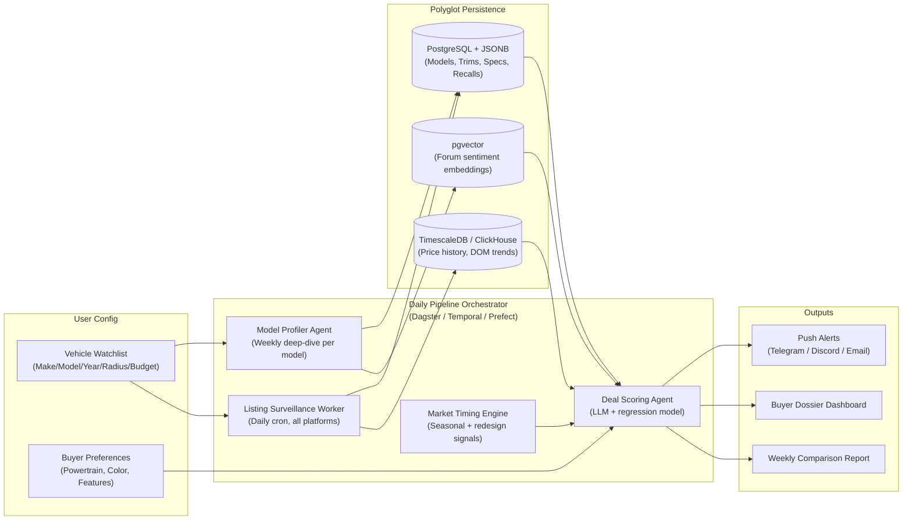

# Car Research Agent: Exhaustive Data Taxonomy

## Critical Review of the Previous Model's Output

The Flash model's initial pass was structurally sound — it correctly identified the two-layer intelligence architecture (Macro model-level vs. Micro listing-level), proposed a reasonable tech stack, and covered the core categories (specs, reliability, safety, sentiment, TCO, listings). The architecture diagram and API source list were solid starting points.

**However, the previous output had several meaningful gaps:**

> [!WARNING]
> ### What the Smaller Model Missed or Underweighted
> 1. **Legal & Regulatory Intelligence** — No mention of class action lawsuits, lemon law buyback histories, state-level regulatory friction (CARB compliance, emissions testing, registration fee structures), or how cross-state purchases introduce hidden costs.
> 2. **Market Timing & Negotiation Intelligence** — Entirely absent. No seasonal pricing cycles, no model-year changeover dynamics, no redesign-cliff depreciation events, no dealer holdback/invoice economics, no volume incentive exploitation strategies.
> 3. **Financing Environment** — Reduced to a generic formula. No captive lender subvented rates, no dealer reserve markup exposure, no credit union pre-approval strategy.
> 4. **Software-Defined Vehicle Risks** — No coverage of OTA update trajectories, subscription fee creep (the BMW heated seats phenomenon), feature stripping on resale (Tesla FSD transfer policies), or connected car data privacy implications.
> 5. **Vehicle Security & Theft Exposure** — Listed as a single bullet. No relay attack vulnerability data, no CAN bus injection awareness, no catalytic converter theft targeting data by model.
> 6. **Color & Configuration Resale Impact** — Completely absent. Color choice alone can swing depreciation by 5–10%.
> 7. **Parts Cost Index & Repair Pricing** — Mentioned conceptually but not sourced. No RepairPal, YourMechanic, or VehicleDatabases API references.
> 8. **Warranty Transferability Nuances** — Mentioned in passing but not decomposed into CPO vs. factory vs. aftermarket, nor the critical transferability restrictions that differ by brand.
> 9. **Competitive Cross-Shopping** — No framework for segment-relative comparison. A car's value proposition only makes sense in context of its direct competitors.
> 10. **Dealer Reputation & Seller Scoring** — No mention of Google Reviews, DealerRater, BBB complaints, or how to score seller trustworthiness algorithmically.

Below is the expanded, corrected, and restructured taxonomy that incorporates all of the above.

---

## The Complete Data Taxonomy

### Layer 1: Model-Level Intelligence (Macro Research)
*Collected once per make/model/year, refreshed weekly or on-demand.*

---

### Category A: Vehicle Identity, Lineage & Configuration Space

Every vehicle exists within a generational lifecycle (typically 5–7 years) with mid-cycle refreshes. The agent must understand this hierarchy to contextualize any data point.

| Data Point | Description | Why It Matters |
|:---|:---|:---|
| **Generation Code** | Internal platform designation (e.g., BMW `G20`, Mazda `ND2`, Toyota `TNGA-K`) | Groups model years that share architecture; separates fundamentally different vehicles sharing a name |
| **Model Year Change Log** | Year-over-year delta of drivetrain, transmission, infotainment, safety, and structural changes | Identifies the "good" and "bad" years within a generation |
| **Assembly Plant** | Factory location decoded from VIN positions 1–3 (WMI) | Correlated with build quality variance (e.g., Japan-built vs. North American-built Toyotas) |
| **Trim Hierarchy** | Base → mid → top trim ladder with original MSRP at each tier | Establishes expected equipment level and price anchoring |
| **Critical Factory Options** | Technology packages, cold-weather packages, adaptive damping, sport packages, LSD, tow packages | These create micro-markets within a trim — a loaded base can be worth more than a stripped mid-trim |
| **Color & Interior Material** | Exterior color, interior color, seat material (cloth/leatherette/leather/Alcantara) | See **Category J** — color and material directly impact depreciation rate |
| **Wheel & Tire Spec** | OEM wheel diameter, tire size, staggered vs. square, run-flat vs. standard | Directly impacts replacement rubber cost (\$600 vs. \$1,600 per set) |

---

### Category B: Powertrain, Energy & Mechanical Architecture

The long-term ownership equation is anchored in what's under the hood (or floor).

#### B.1: Internal Combustion Engine (ICE)
| Data Point | Description |
|:---|:---|
| Engine code & displacement | e.g., Honda K20C1 2.0L Turbo |
| Aspiration | Naturally aspirated vs. turbo vs. supercharged vs. twin-turbo |
| Fuel requirement | Regular 87 vs. Premium 91/93 (adds \$400–\$800/year) |
| Valve timing mechanism | Timing chain (lifetime) vs. timing belt (60k–100k replacement, \$800–\$2,500) |
| Fuel injection type | Port injection vs. Direct injection (DI) vs. Port+DI dual injection. **DI-only engines develop severe intake valve carbon buildup** |
| Transmission type | Planetary torque converter vs. Dual-Clutch (DCT) vs. Belt CVT vs. Chain CVT vs. Manual. Each has radically different longevity profiles |
| Transmission fluid service | Lifetime-fill (myth) vs. recommended interval and cost |

#### B.2: Hybrid & PHEV
| Data Point | Description |
|:---|:---|
| Hybrid architecture | Planetary e-CVT (Toyota HSD) vs. parallel single-clutch vs. P2 hybrid vs. series hybrid |
| HV battery chemistry & capacity | NiMH vs. Li-ion, kWh, all-electric range |
| Inverter reliability | Known failure modes and replacement cost |
| HV coolant service interval | Often overlooked; coolant degrades and can cause premature cell failure |

#### B.3: Electric Vehicle (EV)
| Data Point | Description |
|:---|:---|
| **Battery pack** | Usable vs. gross kWh, cell chemistry (LFP vs. NMC/NCA), module architecture |
| **Thermal management** | Active liquid cooling/heating vs. passive air cooling (early Leaf = avoid) |
| **Cabin HVAC** | Heat pump (critical for winter range) vs. resistive heater |
| **Electrical architecture** | 400V vs. 800V — directly impacts charging speed ceiling |
| **DC fast charge** | Peak kW, 10–80% time, charging curve shape |
| **Onboard AC charger** | 7.4 kW / 11 kW / 19.2 kW — determines home/L2 charging speed |
| **Charging port standard** | CCS1 vs. NACS vs. CHAdeMO (network availability implications) |
| **Battery warranty** | Coverage duration, degradation threshold (usually 70% SoH), **transferability to 2nd owner** |
| **SoH benchmarks by age** | Aggregate fleet SoH data from Recurrent/Geotab by model/year/climate zone |

#### B.4: Drivetrain & Suspension
| Data Point | Description |
|:---|:---|
| Drive layout | FWD / RWD / permanent mechanical AWD (Torsen, DCCD) vs. reactive clutch AWD (Haldex) |
| Suspension type | Conventional steel springs vs. adaptive electromagnetic shocks vs. air suspension (high failure rate post-7 years, \$2,000–\$4,000/corner replacement) |

---

### Category C: Reliability, Defects & Legal Exposure

> [!IMPORTANT]
> An experienced buyer looks for **specific failure modes**, not generic star ratings. This category must go beyond recalls into TSBs, class actions, and community-discovered chronic defects.

#### C.1: Federal Safety & Defect Records
| Source | Data Point |
|:---|:---|
| **NHTSA Recalls** | Open campaigns, remedy availability, safety risk category (fire, brake loss, steering loss) |
| **NHTSA VOQ Complaints** | Raw count, rate per 1,000 units, category breakdown (engine, electrical, powertrain, airbags) |
| **NHTSA TSBs** | Technical Service Bulletins — internal dealer repair procedures for known but non-recalled defects |
| **NHTSA ODI Investigations** | Active Preliminary Evaluations and Engineering Analyses — these are the "pre-recalls" |

#### C.2: Third-Party Reliability Indices
| Source | Data Point |
|:---|:---|
| Consumer Reports | Predicted Reliability score, Owner Satisfaction index, problem area heat maps |
| CarComplaints.com | Severity badges ("Beware of the Clunker", "Seal of Death"), most-reported failure category |
| Dashboard Light | Long-term powertrain reliability index from actual used car trade-in inspections |
| RepairPal | Cost Index rating, average annual repair frequency and cost |

#### C.3: Community-Discovered "Gremlins"
Chronic design flaws that never trigger a recall but define the ownership experience:
- Examples: Ford PowerShift DCT dry clutch shudder, Hyundai/Kia Theta II connecting rod bearing failures, BMW N20/N26 timing chain guide failures, GM AFM/DOD lifter collapses, Tesla Model 3/Y control arm bushing squeaks, Subaru EJ25 head gasket weep
- **Service milestone cost thresholds**: 60k spark plugs + trans flush, 100k timing belt + water pump, 120k suspension bushing refresh

#### C.4: Legal & Regulatory Exposure *(NEW — missed by previous model)*
| Data Point | Description | Why It Matters |
|:---|:---|:---|
| **Active class action lawsuits** | Search `"{make} {model} {year} class action lawsuit settlement"` | A pending settlement may provide free repairs or compensation; an unresolved systemic defect is a financial time bomb |
| **Lemon law buyback history** | Title brand flags: "Manufacturer Buyback" or "Lemon" | Some buybacks are resold after repair; others mask unresolvable defects. Scrubbed titles in certain states mean the history may not appear on CARFAX |
| **CARB compliance status** | 50-state vs. 49-state emissions certification (under-hood label) | If you live in a CARB-adopting state and buy from a federal-only state, your DMV may reject registration |
| **State inspection requirements** | Emissions-only, safety+emissions, or none; annual cost | Hidden recurring ownership cost (\$30–\$100+/year) not reflected in standard TCO calculators |

---

### Category D: Safety, ADAS & Physical Security

#### D.1: Crashworthiness
| Source | Data Points |
|:---|:---|
| **IIHS** | Small overlap front (driver & passenger), updated side impact, roof strength, head restraints, headlight effectiveness, child seat LATCH ease, rear passenger safety |
| **NHTSA 5-Star** | Overall, frontal barrier, side barrier, rollover risk % |

#### D.2: ADAS & Autonomy Hardware
| Data Point | Description |
|:---|:---|
| Level 2 capabilities | Lane centering + adaptive cruise with stop-and-go |
| Sensor suite | Camera-only vs. camera + radar + ultrasonic |
| Driver monitoring | Capacitive steering wheel vs. IR eye-tracking |
| Aftermarket enhancement | Comma.ai / Openpilot hardware compatibility |

#### D.3: Vehicle Security & Theft Exposure *(EXPANDED — was a single bullet)*
| Data Point | Description |
|:---|:---|
| **NICB Hot Wheels theft index** | Model-specific theft rate ranking |
| **Catalytic converter theft risk** | Target list: Prius, F-150, Silverado, Tucson, Explorer, Ram HD. Hybrid converters fetch \$1,400+ on black market due to higher precious metal density |
| **Keyless relay attack vulnerability** | ~85% of keyless entry vehicles are vulnerable. Check if model uses Ultra-Wideband (UWB) secure fob or motion-sleeping fob |
| **CAN bus injection exposure** | Headlight-accessible wiring harnesses allow ECU spoofing. Certain BMW, Land Rover, and Kia/Hyundai models are disproportionately targeted |
| **Engine immobilizer presence** | Some pre-2022 Kia/Hyundai models lacked immobilizers entirely ("Kia Boys" TikTok theft epidemic) |

---

### Category E: Qualitative Sentiment — Critics vs. Real Owners

#### E.1: Journalist / Critic Synthesis
| Source Type | Extraction Targets |
|:---|:---|
| Print/web reviews (Car and Driver, MotorTrend, Edmunds) | Aggregated pros/cons, segment ranking, comparison test placements |
| Technical video reviewers (Savagegeese, Throttle House, Engineering Explained) | Deep mechanical critique, measured road-test metrics |
| EV-specific channels (Out of Spec Reviews, Bjørn Nyland) | Real-world range tests at 70 mph, charging curve measurements, cold weather range loss |
| **Measured metrics to extract** | Real-world 70 mph highway MPG or EV range, 0–60 mph, 60–0 braking, cabin dBA at 70 mph cruise |

#### E.2: Owner Sentiment & Forum Mining
| Source | Extraction Targets |
|:---|:---|
| Reddit (`r/whatcarshouldIbuy`, brand/model subs) | Regret patterns, ownership cost surprises, "what I wish I knew" posts |
| Long-term forums (Bimmerpost, CivicX, Mach-E Club, BobIsTheOilGuy) | Chronic annoyances road tests miss: infotainment lag, seat comfort on 3+ hour drives, A/C underperformance in 95°F+, wind noise sources |
| **Sentiment scoring** | NLP-driven sentiment polarity and topic clustering across 100+ forum threads |

---

### Category F: Software-Defined Vehicle Risk *(NEW — entirely missing from previous model)*

> [!CAUTION]
> Modern vehicles are software platforms. Ignoring this layer means missing costs and risks that didn't exist 5 years ago.

| Data Point | Description | Why It Matters |
|:---|:---|:---|
| **OTA update trajectory** | Does the manufacturer actively push firmware updates? How frequently? What's improved? | A car that gets regular OTAs (Tesla, Rivian, BMW) may gain features over time; one that doesn't is frozen at purchase-date capabilities |
| **Subscription fee inventory** | Recurring fees for: connected services, remote start, traffic-aware navigation, SiriusXM, Wi-Fi hotspot, ADAS features | Can add \$300–\$1,200/year in hidden ownership costs |
| **Hardware-paywalled features** | Features physically present in the car but software-locked behind payment (BMW's heated seats debacle, Tesla's rear heated seats, acceleration boost) | You're paying for hardware you can't use without ongoing fees |
| **Feature transferability on resale** | Does FSD/autopilot or an ADAS subscription transfer to the next owner? Tesla has historically stripped FSD from resold vehicles | Directly impacts resale value and buyer trust |
| **Connected car data privacy** | What driving/location/biometric data does the car collect? Can you opt out without crippling core features? | Privacy risk + potential insurance premium increases from shared driving data |
| **Infotainment platform longevity** | Android Automotive vs. proprietary OS vs. phone projection only (CarPlay/Android Auto). Will the built-in system receive map/app updates in 5 years? | A dead infotainment platform degrades the ownership experience and hurts resale |

---

### Category G: Total Cost of Ownership (TCO) — Expanded

$$\text{TCO} = \text{Depreciation} + \text{Financing} + \text{Insurance} + \text{Fuel/Energy} + \text{Maintenance} + \text{Repairs} + \text{Taxes \& Fees} + \text{Subscriptions} + \text{Tires}$$

> [!NOTE]
> The previous model's TCO formula omitted subscriptions and tires as separate line items. For EVs and performance vehicles, tire cost alone can be \$1,200–\$2,000 every 20,000–30,000 miles.

#### G.1: Depreciation & Market Dynamics
| Data Point | Source |
|:---|:---|
| 1-year, 3-year, 5-year depreciation curves | iSeeCars, CarEdge, NADA/JD Power residual forecasts |
| Days on Market (DOM) — national and regional average | CarGurus, MarketCheck, vAuto |
| Resale liquidity — how fast this model sells | Manheim auction velocity data |
| **Redesign cliff risk** | Is a new generation imminent? An incoming redesign can crater outgoing-gen values by 5–15% overnight |
| **Color depreciation modifier** | Yellow/orange: ~24% 3yr depreciation vs. 31% average. Gold/beige: 34–40%+ |

#### G.2: Financing Intelligence *(NEW — was a generic bullet)*
| Data Point | Description |
|:---|:---|
| **Current credit union pre-approval rate** | Baseline floor rate for your credit tier (typically 0.5–1.5% below dealer markup) |
| **Captive lender subvented rates** | Manufacturer-subsidized 0%–2.99% APR programs on specific models. When available, **no credit union can compete** |
| **Dealer reserve markup risk** | Dealers can markup your approved rate by 1–2% and pocket the spread. Pre-approval neutralizes this |
| **Rate vs. rebate tradeoff** | When manufacturers offer low APR *or* cash back, run amortization math — 0% APR almost always wins over a \$1,500–\$2,000 rebate at 6%+ |

#### G.3: Operational Expenses
| Data Point | Source / Method |
|:---|:---|
| Fuel/electricity cost per 10,000 miles | EPA Combined MPG × regional fuel price, or kWh/100mi × local electricity rate |
| Tire replacement cost & interval | OEM tire size → price lookup; EVs and high-torque vehicles consume OEM tires in 20k–30k miles |
| Insurance group index / annual estimate | Quote with VIN from 3+ carriers before purchase |
| **EV annual registration surcharge** | \$50–\$200+/year in most states to offset lost gas tax revenue |
| Scheduled maintenance cost ladder | RepairPal / YourMechanic cost estimates at 30k, 60k, 90k, 120k mile intervals |
| **Parts cost index** | Price-check 5 common parts (alternator, side mirror assembly, windshield, brake rotors, headlight assembly) on RockAuto/OEM sites. Modern ADAS-equipped bumpers and headlights can cost \$3,000–\$5,000 to replace and recalibrate |

---

### Category H: Market Timing Intelligence *(NEW — entirely absent from previous model)*

> [!TIP]
> A car's price is not just what it's worth — it's when you buy it.

| Signal | Description | Actionable Insight |
|:---|:---|:---|
| **Seasonal pricing cycle** | Prices peak Feb–May (tax refund season), trough Oct–Feb (winter doldrums) | Target purchases in the Oct–Feb window |
| **Model-year changeover** | New model years hit lots in Aug–Sep; every used car "ages" overnight | Shop for outgoing model years in Sep–Oct |
| **Redesign cliff** | When a full redesign launches, outgoing generation prices drop 5–15% | Monitor manufacturer product roadmaps; buy the outgoing gen after the new one is announced |
| **End-of-month/quarter/year** | Dealers chase volume bonuses (stair-step incentives); a dealer 2 cars from hitting a bonus tier will sell at a severe upfront loss | Time offers for the last week of the month, especially Dec/Mar/Jun/Sep |
| **Off-lease wave** | 2–3 year old lease returns flood the market in predictable waves | Target CPO/off-lease inventory for the steepest depreciation bypass |

---

### Category I: Negotiation & Dealer Intelligence *(NEW — entirely absent)*

| Data Point | Description |
|:---|:---|
| **Dealer invoice price** | What the dealer actually paid the manufacturer (publicly available via Edmunds, TrueCar, CarEdge) |
| **Holdback** | 1–3% of MSRP/invoice that the manufacturer refunds to the dealer post-sale. A dealer selling "at invoice" is still profitable |
| **Volume / stair-step incentives** | Extra cash bonuses when dealers hit monthly/quarterly sales milestones |
| **Floor plan assistance** | Manufacturer subsidies on inventory carrying costs — the longer a car sits, the more it costs the dealer |
| **Dealer addendum / markup** | Added sticker above MSRP for hot models + mandatory "protection packages" that cost the dealer ~\$200 but are billed at \$1,500–\$2,500 |
| **F&I office markup** | Extended warranties, GAP insurance, and **interest rate markup** (inflating lender's buy rate by 1–2%) |
| **Out-The-Door (OTD) price** | The only number to negotiate — includes vehicle price, all taxes, doc fees, and mandatory add-ons |
| **Dealer reputation score** | Google Reviews, DealerRater, BBB complaint history, state AG complaints |

---

### Category J: Color & Configuration Resale Impact *(NEW — entirely absent)*

| Color Category | 3-Year Depreciation | Notes |
|:---|:---|:---|
| Yellow / Orange | ~24% | Scarcity drives premium; best on sports cars, trucks, Jeeps |
| White / Silver / Gray | ~30–32% (average) | Maximum buyer pool but maximum supply — neutral financial impact |
| Black | ~30–33% | Hides nothing (scratches, swirls); slight penalty if paint is neglected |
| Red / Blue | ~28–30% | Slight positive vs. average; depends on segment |
| Gold / Beige | ~34–40%+ | Worst performers — small buyer pool with zero enthusiast demand |
| **Interior material** | Leather > Leatherette > Cloth for resale | Leather commands 3–8% premium on luxury/near-luxury segments |

---

### Category K: Competitive Cross-Shopping & Segment Context *(NEW — entirely absent)*

A car's value proposition only makes sense relative to its direct competitors.

| Data Point | Description |
|:---|:---|
| **Segment classification** | Subcompact / Compact / Midsize / Full-size × Sedan / Hatchback / Crossover / SUV / Truck |
| **Direct competitors** | 3–5 models that occupy the same price band, size class, and use case |
| **Feature parity matrix** | Side-by-side comparison of standard features at comparable trims across competitors |
| **Relative depreciation** | How does this model's residual stack against segment rivals? |
| **Relative reliability** | Consumer Reports / JD Power rankings within segment |
| **Price-to-feature ratio** | Which competitor gives the most equipment per dollar at the target trim level? |

---

### Layer 2: Listing-Level Surveillance (Micro — Daily)
*Collected daily for every active listing matching the user's search criteria.*

---

### Category L: Individual Listing Data & Deal Scoring

| Data Point | Description |
|:---|:---|
| **Full 17-digit VIN** | Decodes factory build sheet via NHTSA vPIC or OEM Monroney lookup |
| **Exact spec** | Trim, transmission, drivetrain, color, interior, factory options |
| **Odometer** | Current reading + calculated average miles/year |
| **Listed price** | Current ask price |
| **Price history** | Date of every price reduction, initial listing price, cumulative markdown, days since last drop |
| **Days on Market (DOM)** | >60 days signals negotiation leverage or hidden problems |
| **Residual Delta** | `Listed Price − Algorithmic Fair Market Value` (adjusted for mileage, options, geography). **Negative delta = potential deal** |
| **Title brand** | Clean / Salvage / Rebuilt / Lemon-Buyback / Flood / Hail |
| **Owner count** | 1-owner vehicles command 10–15% premium |
| **Registration type** | Personal vs. Fleet / Rental / Commercial (ex-rentals suffer aggressive wear patterns) |
| **Accident severity** | None / Minor cosmetic / Moderate / Frame damage / Airbag deployment |
| **Service records** | Complete dealer paper trail vs. dark gaps |
| **Geographic origin** | Historical registration locations — Sunbelt/West Coast (good) vs. Rust Belt/Salt roads (bad) |
| **Current location** | Distance from buyer + transport cost estimate |
| **Seller type** | Franchised OEM dealer / Independent lot / Private party / Carvana-style online |
| **Dealer fees** | Doc fee, mandatory dealer packages, "market adjustment" addendum |
| **Listing photo analysis** | CV inspection cues: mismatched tire brands, worn steering wheel inconsistent with odometer, uneven panel gaps, curb rash, interior stains |

---

### Category M: Deal Scoring Algorithm Inputs

The deal score should be a composite that weights:

```
deal_score = f(
    price_vs_market_delta,     # How far below fair market value?
    days_on_market,            # High DOM = more negotiation room
    title_cleanliness,         # Clean >> Rebuilt >> Salvage
    accident_history_severity, # None >> Minor >> Frame
    owner_count,               # Fewer = better
    service_record_completeness, # Full trail = confidence
    geographic_rust_risk,      # Salt belt penalty
    seller_type_trust,         # Franchise dealer > indie lot
    dealer_fee_transparency,   # Low hidden fees = better
    seasonal_timing_bonus,     # Oct–Feb purchase window bonus
    redesign_cliff_factor,     # Incoming redesign = extra leverage
    color_depreciation_mod,    # Enthusiast color = slower loss
    option_desirability,       # Key packages present
    proximity_to_buyer         # Closer = lower acquisition cost
)
```

---

## Data Sources & APIs Summary

| Source | Type | Data Provided | Cost |
|:---|:---|:---|:---|
| **NHTSA vPIC API** | REST / JSON | VIN decode, engine, plant, body class, restraints | Free (public domain) |
| **NHTSA Recalls API** | REST / JSON | Safety recalls by make/model/year | Free |
| **NHTSA Complaints API** | REST / JSON | Consumer complaints (VOQ) | Free |
| **NHTSA Investigations** | REST / JSON | Active ODI investigations | Free |
| **EPA Fuel Economy API** | REST / XML/JSON | MPG, EV range, battery capacity, annual fuel cost | Free |
| **IIHS** | Scrape | Crash test ratings, headlight ratings, ADAS evaluations | Free (scrape) |
| **RepairPal** | Scrape / Partner API | Maintenance cost index, repair frequency, fair price estimates | Free (scrape) / Paid (API) |
| **VehicleDatabases API** | REST / JSON | Repair pricing by VIN or YMM, parts + labor ranges | Paid |
| **RepairSnap API** | REST / JSON | AI-driven repair estimates, state-by-state labor rates | Paid |
| **CarGurus / Autotrader / Cars.com** | Headless scraper (Playwright) | Live listings, price history, DOM, dealer info | Free (scrape) |
| **Facebook Marketplace** | Headless scraper | Private party listings, local deals | Free (scrape) |
| **MarketCheck API** | REST / JSON | Listings aggregation, historical pricing, market analytics | Paid |
| **Manheim MMR** | Enterprise API | Wholesale auction values (real-time market floor) | Paid (enterprise) |
| **Reddit API** | REST / JSON | Forum posts filtered by keywords (fault, problem, recall, regret, repair cost) | Free (with rate limits) |
| **YouTube Data API** | REST / JSON | Video metadata + transcript extraction for review channels | Free (quota limited) |
| **iSeeCars** | Scrape | Depreciation curves, color impact data, deal ratings | Free (scrape) |
| **CarEdge** | Scrape | Depreciation forecasts, dealer invoice, negotiation data | Free (scrape) |
| **Edmunds / TrueCar** | Scrape / Partner API | TMV, invoice pricing, incentives, cross-shopping data | Free (scrape) / Paid (API) |
| **CARFAX / AutoCheck** | Paid per report | Vehicle history, title, accidents, service records | Paid (\$40–\$100/report) |
| **Google Places API** | REST / JSON | Dealer reviews, ratings, complaint patterns | Free tier / Paid |
| **RockAuto** | Scrape | OEM and aftermarket parts pricing | Free (scrape) |
| **Recurrent Auto** | API / Scrape | EV battery SoH benchmarks by model/year/climate | Free tier / Paid |

---

## Architectural Considerations for Next Steps



### Key Decisions to Make Before Building

1. **Target Vehicles**: What makes/models/years/segments are you considering? (This scopes the initial data ingestion)
2. **Geographic Scope**: What's your maximum search radius and home zip code?
3. **New vs. Used vs. Both**: Are you looking exclusively at used, or should the system also track new inventory with incentive programs?
4. **Tech Stack Preferences**: Python + FastAPI + PostgreSQL + Dagster? Or different orchestration/storage preferences?
5. **Alert Channels**: Telegram, Discord, email, or a web dashboard?
6. **Budget for Paid APIs**: Some sources (MarketCheck, VehicleDatabases, CARFAX) require paid access — what's the budget ceiling?
